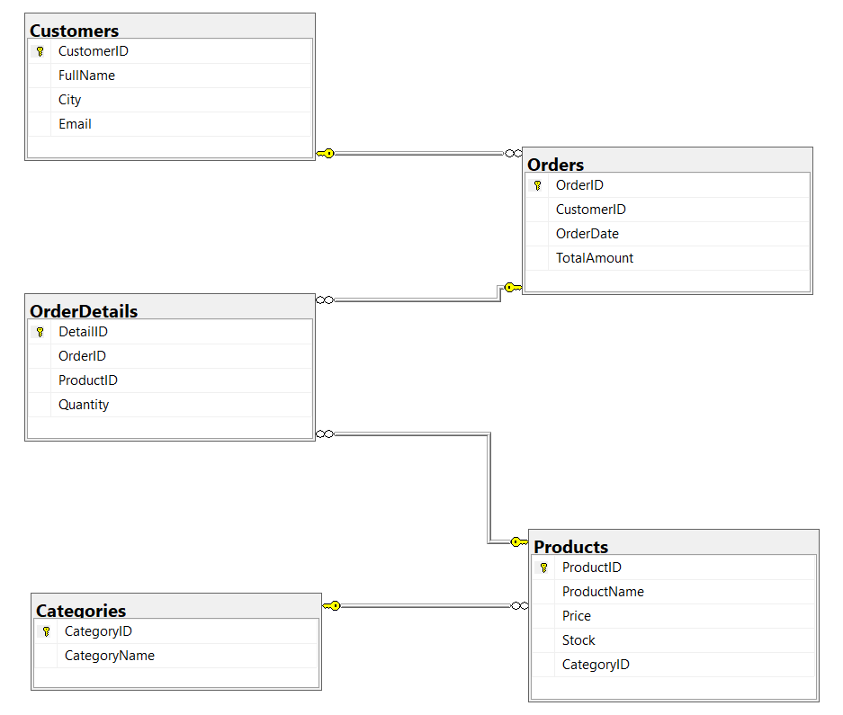
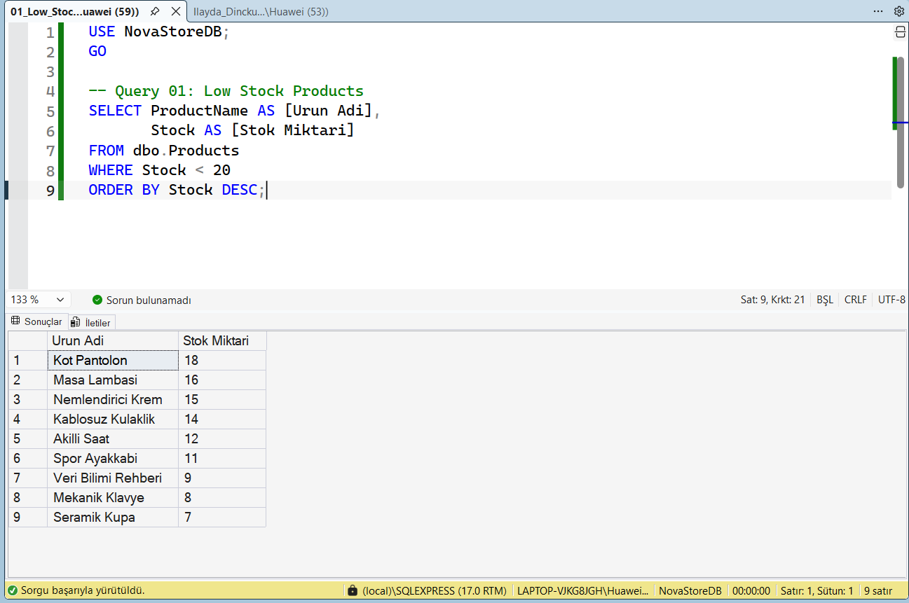
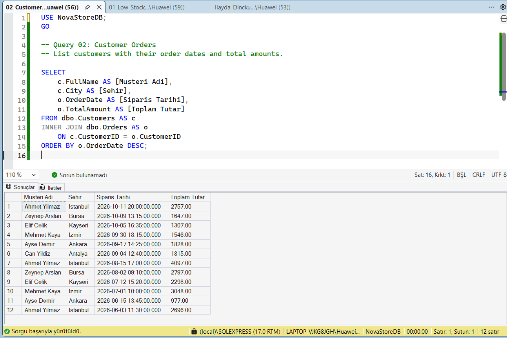
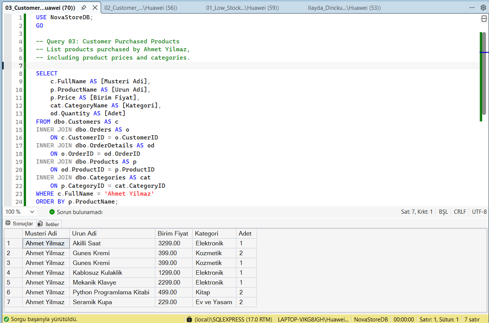
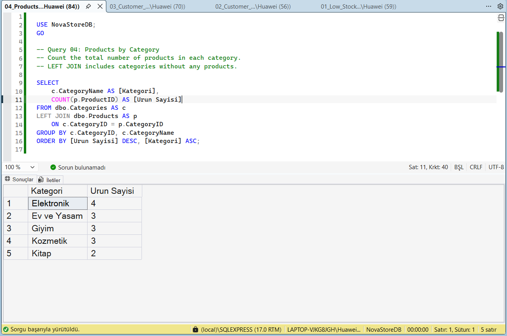
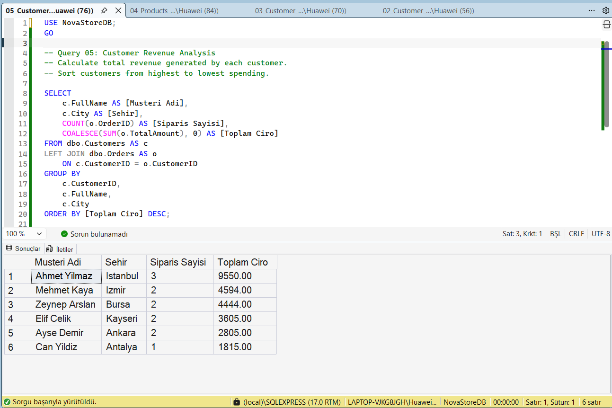
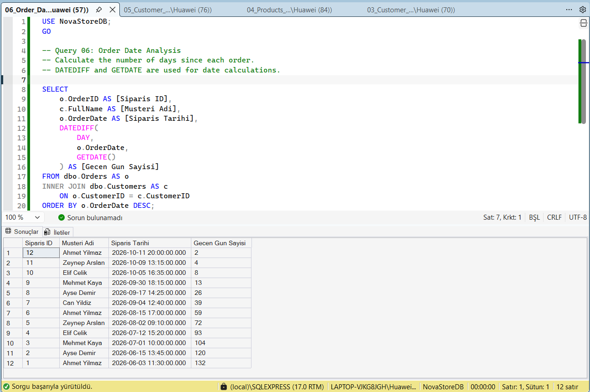
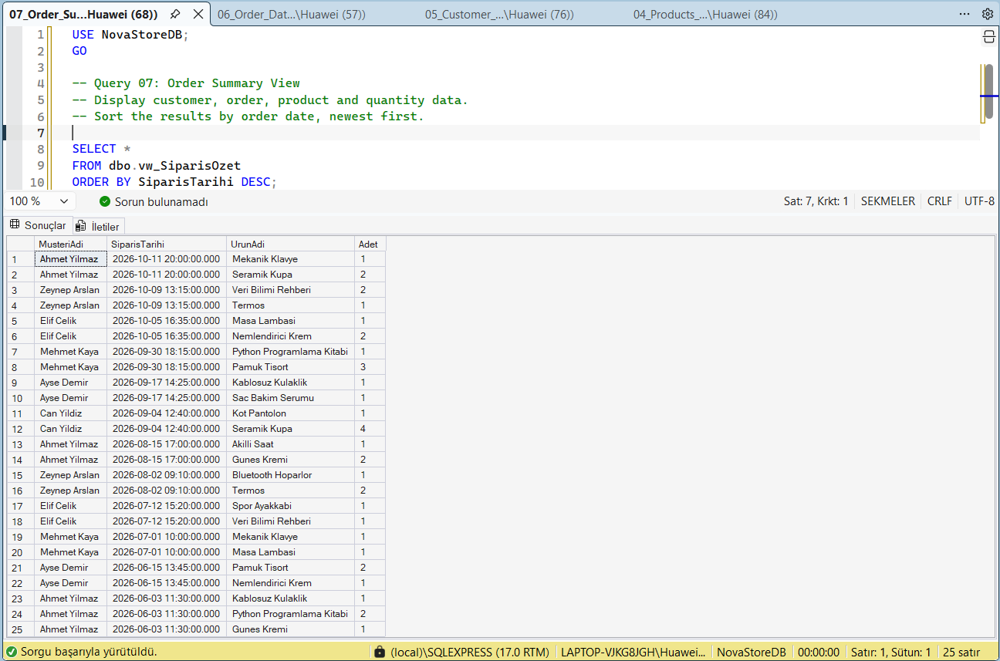
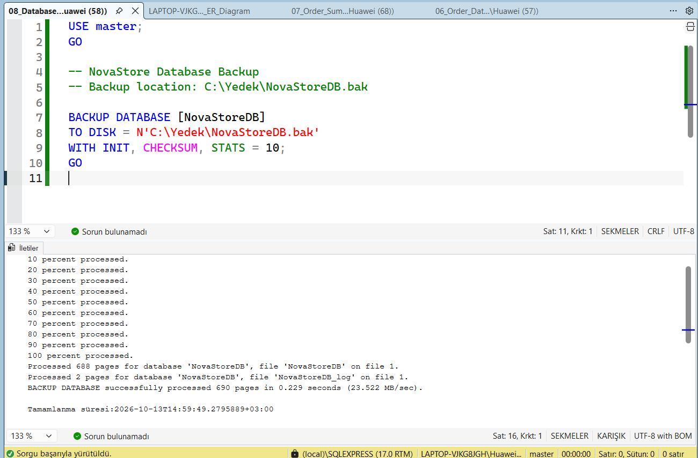
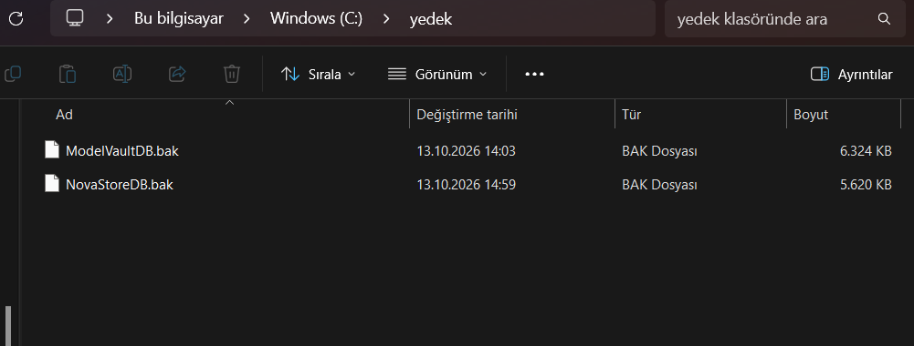

# NovaStore — E-Commerce Database Management System

A relational e-commerce database project implemented with **Microsoft SQL Server (T-SQL)** and validated in **SQL Server Management Studio (SSMS)**.

## Project overview
The database manages customers, product categories, products, orders, and order line items. It demonstrates schema design (DDL), seed data (DML), reporting with JOIN / GROUP BY / SUM / COUNT / DATEDIFF (DQL), a reusable VIEW, and a full database backup.

## Quick start (SSMS)
1. Connect to your SQL Server instance in **SQL Server Management Studio**.
2. Open `Ilayda_Dinckulah_NovaStore_Proje.sql` via **File > Open > File**.
3. Press **Execute (F5)**. The script creates `NovaStoreDB`, its tables, seeds, six required analyses and `dbo.vw_SiparisOzet`.
4. Inspect the **Results** tabs and refresh **Databases** in Object Explorer. Save screenshots for the Word report.
5. For the backup, create `C:\Yedek` **on the SQL Server host**, give the SQL Server service account write permission and run `sql/02_Backup_After_Setup.sql` separately.

> **Existing database safety:** Installation intentionally stops if `NovaStoreDB` already exists. It will **not** erase it. `sql/03_Optional_Reset_DANGER.sql` includes a *commented* destructive reset for deliberate use only.
> The backup is intentionally not auto-executed because `C:\Yedek` and SQL Server service permissions vary by machine.

### Sample dataset

| Table | Records |
| --- | ---: |
| Categories | 5 |
| Products | 15 |
| Customers | 6 |
| Orders | 12 |
| OrderDetails | 25 |

**Demonstration revenue:** 26,813.00 TRY, based on seeded order totals.

## Entity relationship diagram



Relationships: `Categories (1) — (N) Products`, `Customers (1) — (N) Orders`, `Orders (1) — (N) OrderDetails`, and `Products (1) — (N) OrderDetails`.

## Setup
1. Connect to a local SQL Server instance using SSMS.
2. Open `Ilayda_Dinckulah_NovaStore_Proje.sql` and click **Execute (F5)** **once in a clean SQL Server instance where NovaStoreDB does not exist**.
3. The script creates the database and tables, seeds demonstration records, runs the required analyses and creates `dbo.vw_SiparisOzet`.
4. For subsequent inspection, run individual files from `queries/`; **do not rerun the main installation script on the existing database**.
5. For backup, create `C:\Yedek` on the SQL Server host, grant the SQL Server service account write permission, and run `queries/08_Database_Backup.sql` separately. `WITH INIT` can overwrite a previous backup; preserve old backups before rerunning.

> The screenshots document successful execution in a local SQL Server Express environment. The backup `.bak` file is intentionally excluded from this GitHub package.

## SQL queries and execution evidence

### 01. Low Stock Products

Stok miktari 20'den az olan urunleri azalan stok sirasinda listeler. [View SQL](queries/01_Low_Stock_Products.sql).

**Observed result:** 9 urun; en yuksek stok 18, en dusuk stok 7.



### 02. Customer Orders

Musterileri siparisleriyle INNER JOIN kullanarak birlestirir. [View SQL](queries/02_Customer_Orders.sql).

**Observed result:** 12 siparis; musteri, sehir, tarih ve toplam tutar gorunur.



### 03. Customer Purchased Products

Ahmet Yilmaz adli musterinin satin aldigi urun, fiyat, kategori ve adet bilgilerini 5 tabloyla birlestirir. [View SQL](queries/03_Customer_Purchased_Products.sql).

**Observed result:** Ahmet Yilmaz icin 7 siparis detay satiri.



### 04. Products by Category

LEFT JOIN ve GROUP BY ile her kategoride kac urun oldugunu hesaplar. [View SQL](queries/04_Products_By_Category.sql).

**Observed result:** Elektronik 4; Ev ve Yasam 3; Giyim 3; Kozmetik 3; Kitap 2.



### 05. Customer Revenue

SUM ve GROUP BY ile musterilere gore siparis sayisi ve toplam ciro analizi yapar. [View SQL](queries/05_Customer_Revenue.sql).

**Observed result:** Toplam ciro 26.813,00 TL; en yuksek musteri cirosu Ahmet Yilmaz 9.550,00 TL.



### 06. Order Date Analysis

DATEDIFF ve GETDATE kullanarak siparislerden bu yana gecen gun sayisini hesaplar. [View SQL](queries/06_Order_Date_Analysis.sql).

**Observed result:** 12 siparis icin gecen gun; sonuclar sorgunun calistigi tarihe baglidir.



### 07. Order Summary VIEW

Ana SQL dosyasinda olusturulan vw_SiparisOzet gorunumunu sorgular. [View SQL](queries/07_Order_Summary_View.sql).

**Observed result:** 25 detay satiri; MusteriAdi, SiparisTarihi, UrunAdi, Adet.



### 08. Database Backup

C:\Yedek konumuna tam yedek olusturur; ana kurulumdan AYRI calistirilmalidir. [View SQL](queries/08_Database_Backup.sql).

**Observed result:** SQL Server 690 sayfayi basariyla yedeklemistir (13.10.2026).



### Backup file evidence



## Project structure

```text
.
├── Ilayda_Dinckulah_NovaStore_Proje.sql   # One-file required submission
├── Ilayda_Dinckulah_NovaStore_Proje.docx  # Report with genuine SSMS screenshots
├── Ilayda_Dinckulah_NovaStore_Proje.png   # ER diagram image
├── queries/                              # Individual demonstrations (01–08)
├── screenshots/                          # Real SSMS and backup evidence
└── README.md
```

## Notes
- The demonstration dataset uses fictional customers and example.com email addresses.
- Monetary aggregates use seeded order totals, which were cross-checked against the sum of quantity × product price.
- Date analysis is dynamic: values change depending on the SQL Server execution date.
- The diagrams and screenshot images are from the project's SSMS execution, not simulated result tables.

## Author
İlayda Dinçkülah — SQL Server / Database Project (2026)
